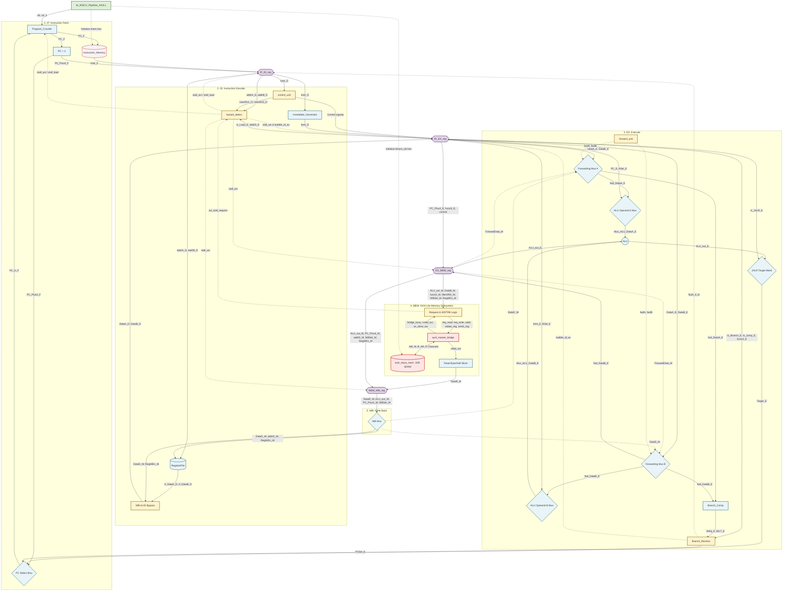

# RISC-V 5-Stage Pipelined Processor with AMBA AXI4-Lite Bus & AXI4 Slave Memory (RV32I)

## Project Overview
This repository contains the RTL design, two-phase verification environment, and cycle-accurate performance evaluation for a custom **32-bit RISC-V 5-Stage Pipelined Processor (RV32I)** integrated with an industry-standard **AMBA AXI4-Lite Data Bus and 1KB AXI4-Lite Slave Memory**.

Evolved from a baseline 5-stage pipelined processor (`IF` $\rightarrow$ `ID` $\rightarrow$ `EX` $\rightarrow$ `MEM` $\rightarrow$ `WB`) with ideal single-cycle Data Memory (DMEM), this project decouples the CPU core from physical SRAM using a custom **AXI4-Lite Master Bridge** and **AXI4-Lite Slave Memory** subsystem. The design implements strict `VALID`/`READY` channel handshakes, hardware byte-level write masking (`WSTRB`), address range decoding (`OKAY`/`DECERR`), global pipeline stalling during multi-cycle bus wait-states, and hazard priority arbitration to handle back-to-back memory transactions without instruction or data loss.

## Key Features
- **RV32I Base Integer Instruction Set**: Support for R-Type, I-Type, Load/Store (`lb`, `lh`, `lw`, `lbu`, `lhu`, `sb`, `sh`, `sw`), Branch, Jump (`jal`, `jalr`), and Upper-Immediate (`lui`, `auipc`) instructions.
- **5-Stage Pipeline Execution**: Instruction Fetch (`IF`), Instruction Decode (`ID`), Execute (`EX`), Memory Access (`MEM`), and Write Back (`WB`) isolated by four synchronization pipeline registers (`IF/ID`, `ID/EX`, `EX/MEM`, `MEM/WB`).
- **AMBA AXI4-Lite Memory Subsystem**: Replaces ideal single-cycle DMEM with a modular `axi4_subsystem` featuring five independent AXI4-Lite channels (`AW`, `W`, `B`, `AR`, `R`) with deadlock-free `VALID`/`READY` handshakes.
- **Sub-Word Alignment & Byte-Level Masking (`WSTRB`)**: Dedicated MEM-stage alignment logic shifts store payloads and generates 4-bit `WSTRB` strobes for `sb`, `sh`, and `sw`, while slicing and sign/zero-extending read payloads for `lb`, `lh`, `lbu`, and `lhu`.
- **Address Decoding & Error Reporting**: 1KB Slave SRAM mapped to `0x0000_0000` – `0x0000_03FF` ($256 \times 32$-bit words), returning `OKAY` (`2'b00`) for valid accesses and `DECERR` (`2'b11`) for out-of-bounds requests.
- **Conflict-Free Pipeline Stall & Hazard Arbitration**: Combinational stall request (`axi_stall_request`) immediately freezes all pipeline stages (`PC` through `MEM/WB`) upon issuing a memory transaction, while gating Load-Use bubble injection (`!bridge_busy`) to prevent premature instruction flushing while the AXI bus is active.
- **Data Forwarding & Early Branch Resolution**: Dynamically bypasses results from `EX/MEM` (`ForwardData_M`) and `MEM/WB` (`DataD_W`) to the ALU, Branch Comparator, and Store Data path, while resolving branches/jumps in the `EX` stage.

---

## Hardware Architecture

The hardware architecture partitions the processor into the 5-stage RV32I core (`RISCV_Pipeline_AXI4.v`) and the decoupled AXI4-Lite memory subsystem (`axi4_subsystem.v`).



---

### AXI4-Lite Protocol State Machines (FSMs)

Both the Master Bridge and Slave Memory employ decoupled Read  and Write Finite State Machines to support independent channel handshaking without bus deadlock.

#### 1. AXI4-Lite Master Bridge FSM (`axi4_master_bridge.v`)
[](images/AXI4%20Master%20Bridge%20FSM.png)

#### 2. AXI4-Lite Slave Memory FSM (`axi4_slave_mem.v`)
[](images/AXI4%20Slave%20Mem%20FSM.png)

---

### Module Descriptions by Pipeline Stage

1. **Stage 1: IF (Instruction Fetch)**
   - **`Program_Counter.v`**: Synchronous PC register gated by `pc_en = !stall_axi && (PCSel_E || !stall_load)`. Holds its state during Load-Use stalls and AXI bus wait-states, while prioritizing `EX`-stage branch redirects when the AXI bus is idle.
   - **`IMEM.v`**: Word-aligned Instruction Memory initialized via `imem.hex`.
   - **`IF_ID_reg.v`**: Synchronizes `PC_F`, `PC_Plus4_F`, and `Instr_F` into the Decode stage; supports synchronous `stall` (`stall_load || stall_axi`) and branch `flush` (`PCSel_E`).

2. **Stage 2: ID (Instruction Decode)**
   - **`control_unit.v` (`main_decoder.v` & `ALU_decoder.v`)**: Generates datapath control signals along with explicit source-register usage flags (`UsesRs1_D`, `UsesRs2_D`) to prevent false-positive hazard stalls.
   - **`RegisterFile.v`**: $32 \times 32$-bit register array (`x0` hardwired to 0) paired with a **WB-to-ID write-through bypass** (`DataA_D`, `DataB_D`) for same-cycle read-after-write resolution.
   - **`Imm_Gen.v`**: Sign-extends immediate fields across I, S, B, U, and J instruction formats.
   - **`hazard_detect.v` (Modified for AXI4-Lite)**: Arbitrates between multi-cycle AXI memory stalls and single-cycle Load-Use stalls:
     - Asserts `stall_axi = bridge_busy` (driven by `axi_stall_request`) to freeze the entire pipeline.
     - Gates `stall_load` with `&& !bridge_busy` so the `ID/EX` stage is **never erroneously flushed with bubbles** while an upstream Load/Store is waiting on the AXI4-Lite bus.
   - **`ID_EX_reg.v`**: Propagates decoded operands and control signals to `EX`. Freezes when `stall_axi` is high; injects a `NOP` bubble (`bubble_id_ex = PCSel_E || stall_load`) only when safe.

3. **Stage 3: EX (Execute)**
   - **`forward_unit.v`**: Resolves RAW hazards dynamically by selecting between register operands (`2'b00`), `MEM/WB` write-back data `DataD_W` (`2'b01`), and `EX/MEM` result `ForwardData_M` (`2'b10`, prioritizing `EX/MEM`).
   - **`ALU.v`**: Executes arithmetic, logical, shift, comparison, and memory address calculations.
   - **`Branch_Comp.v` & `Branch_Resolve.v`**: Evaluates signed/unsigned branch conditions (`BrUn_E`) and computes branch/jump targets (`Target_E` with LSB masking for `jalr`) in `EX`.
   - **`EX_MEM_reg.v`**: Latches `ALU_out_E`, forwarded store data `fwd_DataB_E`, `PC_Plus4_E`, and memory controls; stalls on `stall_axi`.

4. **Stage 4: MEM (Memory Access via AXI4-Lite Subsystem)**
   - **CPU-to-AXI Request & Alignment Logic (`RISCV_Pipeline_AXI4.v`)**:
     - Tracks in-flight transfers via `axi_active` to issue clean single-shot requests (`req_read`, `req_write`) when `!axi_active && !bridge_busy`.
     - Asserts `axi_stall_request = (Is_Load_M && !rvalid_axi) || (MemRW_M && !wr_done_axi)` to freeze all pipeline registers until the transaction completes, releasing on the exact clock edge `rvalid_axi` or `wr_done_axi` pulses high.
     - Replicates sub-word store data (`{4{DataB_M[7:0]}}`, `{2{DataB_M[15:0]}}`) and shifts `wstrb_reg` according to byte offset `ALU_out_M[1:0]`; slices `rdata_axi` (`selected_byte`, `selected_half`) for signed/unsigned sub-word loads.
   - **`axi4_subsystem.v`**: Structural wrapper interconnecting `axi4_master_bridge` and `axi4_slave_mem` across all 5 AXI4-Lite channels.
   - **`axi4_master_bridge.v`**: Converts native CPU requests into AXI4-Lite transactions. In `W_AW_W_VALID`, independent `aw_done` and `w_done` flags automatically de-assert `m_axi_awvalid` and `m_axi_wvalid` upon individual channel completion to prevent protocol violations and deadlocks.
   - **`axi4_slave_mem.v`**: Models a 1KB synchronous SRAM (`256` words $\times$ `32` bits) mapped to `0x0000_0000` – `0x0000_03FF`. Supports independent `AW` and `W` channel latching, byte-selective writes via `s_axi_wstrb[3:0]`, and address boundary checking (`OKAY = 2'b00`, `DECERR = 2'b11`).
   - **`MEM_WB_reg.v`**: Captures aligned `DataR_M` directly on the completion cycle when `stall_axi` releases.

5. **Stage 5: WB (Write Back)**
   - **Write-Back Multiplexer**: Selects between `DataR_W` (`2'b00`), `ALU_out_W` (`2'b01`), and `PC_Plus4_W` (`2'b10`) to write back into `RegisterFile`.

---

## Instruction Set Architecture (ISA) Support

| Type | Instructions Supported | Description |
| :--- | :--- | :--- |
| **R-Type** | `add`, `sub`, `and`, `or`, `xor`, `sll`, `srl`, `sra`, `slt`, `sltu` | Register-to-register arithmetic, logical, shift, and comparison operations. |
| **I-Type** | `addi`, `slti`, `sltiu`, `xori`, `ori`, `andi`, `slli`, `srli`, `srai`, `lb`, `lh`, `lw`, `lbu`, `lhu`, `jalr` | Register-immediate operations, AXI4-Lite sub-word/word loads, and indirect jump. |
| **S-Type** | `sb`, `sh`, `sw` | Byte, Halfword, and Word stores to AXI4-Lite Slave Memory using `WSTRB`. |
| **B-Type** | `beq`, `bne`, `blt`, `bge`, `bltu`, `bgeu` | Conditional branches resolved in the `EX` stage. |
| **U-Type** | `lui`, `auipc` | 20-bit upper-immediate instructions. |
| **J-Type** | `jal` | Unconditional jump and link (`PC + 4` saved to `rd`). |

---

## Verification Environment

The project employs a rigorous **two-phase hardware/software verification methodology** to validate protocol compliance in isolation prior to full-system pipeline integration.

### Phase 1: Standalone AXI4-Lite Subsystem Verification (`tb_axi4_subsystem.v`)
Before connecting the RISC-V pipeline, `tb_axi4_subsystem.v` emulates CPU bus masters (`cpu_write` / `axi_write` and `cpu_read` / `axi_read` tasks) to verify the `axi4_subsystem` wrapper directly

[View Verification Plan AXI4 subsystem (pdf)](Verification_plan_AXI4_subsystem.pdf)

**Verification result AXI4 standalone test**
[](images/AXI4%20standalone%20test%20results.png)

### Phase 2: Full System Integration & Self-Checking Workload (`tb_RISCV_Pipeline_AXI4.v` & `sw/test.S`)
The RISC-V GNU toolchain compiles `sw/test.S` into `mem/imem.hex` and `mem/dmem_init.hex`. The self-checking program validates results via `bne` branches and writes the final status to architectural register `x7` (`x7 = 1` for **PASS**, `x7 = -1` / `0xFFFFFFFF` for **FAIL**):

[View Verification Plan Pipeline AXI4 (pdf)](Verification_plan_pipeline_AXI4.pdf)

---

## Performance Evaluation (Baseline RV32I 5-Stage Pipeline vs. AXI4-Lite)

Both the RV32I 5-Stage Pipeline Baseline core and the upgraded AXI4-Lite processor execute the exact same compiled `test.S` workload on **Cadence Xcelium**, demonstrating **100% functional equivalence** (`x7 = 1`).

| Metric | Baseline Pipeline (Ideal DMEM) | Upgraded Pipeline (AXI4-Lite Bus) | Delta / Analytical Notes |
| :--- | :---: | :---: | :--- |
| **Test Status (`x7`)** | `PASSED` (`1`) | `PASSED` (`1`) | 100% architectural equivalence |
| **Total Execution Cycles** | `195` | `279` | `+84` cycles ($195 + 84 = 279$) |
| **Pipeline Load-Use Stall Cycles** | `13` | `13` | Identical internal hazard behavior preserved |
| **AXI Write (Store) Transactions** | N/A | `14` | `42` total write wait-state cycles ($3$ cycles/tx) |
| **AXI Read (Load) Transactions** | N/A | `14` | `42` total read wait-state cycles ($3$ cycles/tx) |
| **Total AXI Wait-State Overhead** | `0` | `84` | Exact match: $28 \text{ transactions} \times 3 \text{ cycles} = 84$ |

**AXI4 Pipeline Test Results**

[](images/AXI4%20pipeline%20test%20results.png)

**Pipeline Test Results**

[](images/Pipeline%20test%20results.png)

### Architectural Takeaways & Future Work
- **Cycle-Accurate Proof**: Total execution time scales deterministically:
  `Total Cycles (AXI) = Total Cycles (Baseline) + AXI Wait-State Cycles = 195 + 84 = 279 cycles`
- **Future Enhancements**: To mitigate the $3$-cycle per-access AXI4-Lite latency penalty on CPI, the modular `MEM` interface can be extended with a direct-mapped **L1 Data Cache (D-Cache)** between the CPU and `axi4_master_bridge`, or upgraded to **AMBA AXI4-Full** to leverage burst transfers (`AWLEN`/`ARLEN`) during sequential array loops.

---

## Simulation & Synthesis (Cadence EDA Flow)

This project uses the **RISC-V GNU Toolchain** (`riscv32-unknown-elf-gcc`) for software image generation and industry-standard **Cadence EDA tools** (**Xcelium** for simulation, **SimVision** for waveform debugging, and **Genus** for logic synthesis).

### 1. Software Compilation (`test.S` $\rightarrow$ `.hex`)
Build `mem/imem.hex` and `mem/dmem_init.hex` and inspect the disassembly:
```bash
make hex
make disasm
```

### 2. RTL Simulation (Cadence Xcelium)

**Compile RTL & Testbench:**
```bash
make compile
```

**Elaborate the Top-Level Design:**
```bash
make build TOP_TB=tb_RISCV_Pipeline_AXI4
```

**Run Full-System Simulation:**
```bash
make run TOP_TB=tb_RISCV_Pipeline_AXI4
```

**Run Standalone AXI4-Lite Subsystem Testbench:**
```bash
make run TOP_TB=tb_axi4_subsystem TB_FILE=./tb/tb_axi4_subsystem.v
```

**Launch Waveform Viewer (Cadence SimVision):**
```bash
make wave TOP_TB=tb_RISCV_Pipeline_AXI4
```

### 3. Logic Synthesis (Cadence Genus)

Run synthesis and automated clock-period sweeping:
```bash
make syn TOP_SYN=RISCV_Pipeline_AXI4
```

Clean generated build artifacts and logs:
```bash
make clean
```

---

